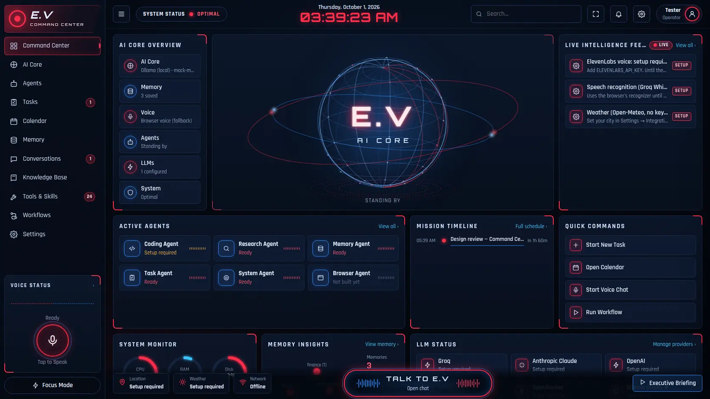

# E.V. — Personal AI Assistant

E.V. is a personal AI assistant that runs on your Windows laptop and opens in your browser. You can also use it from your phone. It chats with you by text or voice, keeps a memory you can inspect and edit, manages tasks, a calendar, documents, and scheduled workflows, and reads folders you allow it to. It can never send, delete, or buy anything without your explicit approval.



> **About the interface:** I built this interface from your dashboard mockup (`docs/design-reference.webp`) because the HTML file itself hasn't been shared yet. The interface (`frontend/`) is completely separate from the backend, so when you send your HTML I can wire it to the same API. See [Using your own HTML](#using-your-own-html-interface).

---

## What works today (honest status)

| Capability | Status | What it needs |
|---|---|---|
| Typed chat with streamed replies, a Stop button, and readable errors | ✅ Works | One AI provider key |
| AI providers: **Groq**, **Claude (Anthropic)**, OpenAI, Gemini, OpenRouter, Ollama (local) | ✅ Built (see note) | That provider's key; for Ollama, Ollama running locally |
| Fallback provider if the main one fails | ✅ Works | A second provider |
| Tools with permission levels, approval cards, timeouts, and an audit log | ✅ Works | — |
| Memory you can view, add, correct, export, import, and delete | ✅ Works | — |
| Tasks and a local calendar | ✅ Works | — |
| Knowledge Base: PDF, Word, and text files, with cited answers | ✅ Works | — (scanned PDFs aren't supported because there's no OCR) |
| Workflows: reminders, briefings, recurring read-only prompts | ✅ Works while E.V. is running | — |
| Executive Briefing built from your real data | ✅ Works | Works best with a provider set up |
| Voice input | ✅ Works | `GROQ_API_KEY` (Whisper), or Chrome/Edge's built-in recognizer |
| Voice output | ✅ Works | `ELEVENLABS_API_KEY` for your voice; otherwise the browser's voice |
| Weather (Open-Meteo, free) | ⚙️ Setup required | Your city |
| GitHub "PRs awaiting your review" | ⚙️ Setup required | `GITHUB_TOKEN` |
| Sending email (each message approved by you) | ⚙️ Setup required | SMTP settings + `SMTP_PASSWORD` |
| **Fire TV remote**: buttons, play/pause, volume, sleep/wake, open apps, "what's on" | ⚙️ Setup required | Fire TV IP + ADB debugging + Android platform-tools ([see below](#fire-tv-and-alexa)) |
| E.V.'s voice through your Echo | ✅ Works | Pair the Echo as a Bluetooth speaker (no code involved) |
| Reading files and creating files on your laptop | ⚙️ Setup required | Folders you authorize |
| Google Calendar sync, Gmail inbox, web search, browser automation, calls/SMS, purchases and bookings | 🚧 Planned, not built | The app labels these "Not built yet" |

**Note on testing:** All 56 automated tests pass. I also ran full browser walkthroughs: first-run setup, streamed chat, a tool call, the approval card, approving it, and the task being created, at both desktop and phone sizes; plus "Pause the TV" through to the ADB command, using a stand-in for `adb` because no Fire TV is reachable from my build environment. **However, my build environment's network blocks Groq, ElevenLabs, and Open-Meteo**, so I tested those integrations against simulated (mocked) APIs, not the real services. The first real call happens on your laptop. The **Test** buttons in the app check each integration and report the result.

---

## Quick start (Windows)

1. **Install Python 3.12 or newer** from [python.org/downloads](https://www.python.org/downloads/). During setup, tick **"Add python.exe to PATH"**.
2. **Get the code.** On GitHub, click *Code → Download ZIP* and extract it, or run `git clone`.
3. **Double-click `start_ev.bat`.** The first run installs everything (about a minute). Your browser then opens at **http://localhost:8000**.
4. **Create a passcode** (6 or more characters). For safety, this only works from the laptop itself.
5. **Connect Groq:** open **AI Core → Groq**, paste your key, and click **Save key**. Then click **Test & load models**, pick a model, and click **Save model**.
   - The default model is `openai/gpt-oss-120b`, which is good at tool use. If it isn't in the list, pick another one; `llama-3.3-70b-versatile` is a common choice. Model lists change, so the app always loads the current list from Groq rather than relying on a hard-coded one.
6. **Voice (optional):** open **Settings → API keys** and add `ELEVENLABS_API_KEY`. Your voice ID `mmr1IUaAlIQE2pSB8y0J` is already filled in. The model is `eleven_multilingual_v2`, the one from your curl example. Switch to `eleven_flash_v2_5` if you want faster replies.
7. **Optional extras** in Settings: your city (for weather), folders E.V. may read or write, GitHub, and SMTP email.

To start E.V. again later, double-click `start_ev.bat`. To stop it, close that window or press Ctrl+C.

> 🔐 **Please rotate your Groq key.** You pasted it into a chat message, so it now sits in that conversation's history. Create a new key at [console.groq.com/keys](https://console.groq.com/keys), paste it into E.V., and delete the old key. I never wrote your key into any file in this repository. A test (`test_no_secrets_committed`) fails if a key ever gets committed.

---

## Using E.V.

- **Talk to E.V.** (the bottom bar) opens the chat. Use the dropdown to switch **agents**: Coding, Research, Memory, Task, and System. Each agent can only use its own set of tools, and the backend enforces this.
- **Voice:** tap the microphone. E.V. stops listening after about 1.4 seconds of silence, transcribes what you said, and **speaks its reply** when you used your voice. To have typed replies read aloud too, turn that on under Settings → Voice.
- **Approvals:** when E.V. wants to do something that needs your permission, an approval card shows the exact action. **Nothing happens until you click Approve.** The **Stop** button cancels a reply at any point.
- **Memory:** E.V. only knows what's listed on the Memory page. When it suggests remembering something, you approve it first. You can correct entries, export them to JSON, import them, or delete them.
- **Knowledge Base:** drop in PDFs, Word files, or notes. Answers cite their sources, like `[budget.pdf p.3 · D2]`.
- **Workflows:** schedule reminders, a daily briefing, or a recurring question such as "check my overdue tasks". These run in the background while E.V. is open.
- **Executive Briefing** (bottom right): a summary of your day built only from your real data.
- **Search** (top bar) looks across tasks, memories, documents, and conversations. **Focus Mode** hides the non-essential panels.

### Personality
In **AI Core → Personality** you can set your preferred name, the wit level (off, light, or playful), and verbosity (brief, balanced, or detailed). You can also add your own instructions there, for example: *"Use metric units. Challenge my assumptions. Keep finance advice conservative."* E.V. answers first and gives details after. It labels facts, estimates, and unknowns, and it never jokes about health, money, or personal struggles.

---

## Permissions: enforced in code, not by asking the AI nicely

| Level | Examples | What happens |
|---|---|---|
| **Read** | List tasks, search documents, read an authorized file, weather | Runs automatically |
| **Prepare** | Draft an email (it's saved, not sent) | Runs automatically |
| **Reversible write** | Create or update tasks and events, save a memory, create a file in a writable folder | **Asks you** by default. You can switch this to automatic in Tools & Skills. Memories always ask unless you turn that off. |
| **External / destructive** | Send email, delete a task, event, or memory | **Always asks you. This can't be turned off.** |

How the backend enforces this:
- Every tool input is checked against a schema (Pydantic) before anything runs.
- An approval only covers the **exact** arguments you saw. The backend re-checks the stored approval record when it executes the action.
- Background workflows are limited to the Read and Prepare levels. They can't trigger an approval prompt, so anything that would need one is refused.
- Each tool has a timeout. You can disable any tool in **Tools & Skills**.
- Every attempt is written to the **Audit log**: allowed, denied, failed, or timed out.
- File access is limited to folders you authorize. `.env` files, keys, and E.V.'s own data are always blocked. Overwriting a file saves a backup in `data/backups/` first.

---

## Fire TV and Alexa

Everything here stays on your home network. Nothing goes through the internet, and nothing is exposed to it.

### Hear E.V. through your Echo (2 minutes)
1. Say **"Alexa, pair Bluetooth."**
2. On the laptop, open **Settings → Bluetooth & devices → Add device → Bluetooth** and pick your Echo.
3. In E.V., turn on **Settings → Voice → "Also speak replies to typed messages"** if you want every answer read aloud.

E.V. now speaks from the Echo in your ElevenLabs voice. You still talk to E.V. through the laptop or phone mic, because the Echo's microphone belongs to Alexa. (A spoken "Alexa, ask E.V. …" skill would require exposing E.V. to the internet, so it isn't included.)

### Let E.V. control your Fire TV (about 10 minutes)
1. **Turn on ADB debugging on the Fire TV:** Settings → My Fire TV → Developer options → **ADB debugging: ON**. If you don't see Developer options, go to My Fire TV → About and click your device name 7 times.
2. **Find the TV's IP address:** My Fire TV → About → Network (for example `192.168.1.40`). In your router, give it a fixed (reserved) IP so it doesn't change.
3. **Get ADB for Windows:** download Google's [Android SDK Platform-Tools](https://developer.android.com/tools/releases/platform-tools) ZIP and extract it **into your E.V. folder**, so you have `EV\platform-tools\adb.exe`. E.V. finds it automatically.
4. In E.V., open **Settings → Fire TV**, enter the IP, click **Save**, then **Test connection**.
5. **On the TV**, an "Allow USB debugging?" box appears. Tick **Always allow from this computer** and press **OK**. Then click **Test connection** again.

Now you can say things like *"pause the TV"*, *"turn the volume up three"*, *"open Netflix"*, *"put the TV to sleep"*, or *"what's on the TV?"*.

- **Approvals:** TV commands ask first, like any change. To make the remote instant, go to **Tools & Skills**, find `tv_remote` (and `tv_open_app` if you like), and switch on **run without asking**. Sending, deleting, memory changes, and scheduling can never skip approval.
- **What E.V. can confirm:** ADB confirms that a button press *reached* the TV. It can't see the screen, so E.V. won't claim more than that.
- **Volume:** on some setups the TV, not the Fire Stick, controls volume, so volume commands may have no effect.
- **Security:** while ADB debugging is on, any device on your Wi-Fi could *ask* the TV for access. Only devices you approve on the TV screen get in. Turn ADB debugging off if you stop using this.

## Phone access

**Option A: Tailscale (recommended).** You get HTTPS, so the microphone works, and E.V. isn't exposed to your Wi-Fi network.
1. Install [Tailscale](https://tailscale.com/download) on your laptop and phone, and sign in to the same account on both.
2. In the Tailscale admin console, enable **MagicDNS** and **HTTPS certificates**.
3. On the laptop, run `tailscale serve --bg 8000`, then `tailscale serve status` to see your `https://…ts.net` address.
4. Open that address on your phone and sign in with your passcode. To make it feel like an app, use your browser's "Add to Home Screen".

**Option B: Same Wi-Fi.** Typing works, but the microphone won't, because phone browsers require HTTPS for it.
1. In `.env`, set `EV_HOST=0.0.0.0` and restart E.V. The window prints your phone address, such as `http://192.168.1.20:8000`.
2. When Windows Firewall asks, allow access on **Private networks only**.

---

## Security and privacy

- **Keys are stored only in `.env`** on your laptop. The browser never receives them; it only sees "Configured ••••abcd". E.V. **ignores keys in your Windows environment variables**, so a key set up for another program is never used unless you add it here.
- **Sign-in:** your passcode is hashed with PBKDF2 (600,000 iterations). Sessions use HttpOnly, SameSite=Strict cookies. Every request that changes something needs a CSRF header. There's a strict Content-Security-Policy, and repeated wrong passcodes are rate-limited.
- **Your data** is stored in `data/` (`ev.db` plus your uploads and backups). Back up that folder. To start fresh, delete it.
- **What gets sent to AI providers:** your messages, E.V.'s instructions (including your saved memories), and tool results, such as the text of a file you ask it to read. If something must never leave your laptop, use **Ollama** as the provider.
- **Claude (Anthropic) settings:** the default model is `claude-opus-5-5`, using adaptive thinking and an effort level you choose. Server-side refusal **fallbacks** (`fallbacks: "default"`) are switched on, so a declined request can be retried on Anthropic's recommended fallback model; turn this off in `backend/providers/anthropic_provider.py` if you'd rather not. Conversation history stays append-only (stale thinking blocks are dropped, not rejected).

---

## How it's built

```
Browser (frontend/: HTML + CSS + JS, no build step)
   │  fetch + streamed events (passcode session, CSRF header)
   ▼
FastAPI backend (backend/)
   ├── routes/        HTTP API: auth, chat (streaming), data, system/settings/voice
   ├── services/
   │     chat.py      conversation engine: stream → tool calls → approvals → cancel
   │     persona.py   E.V.'s instructions from your settings and memories
   │     agents.py    focused modes and their tool lists
   │     approvals.py / jobs.py / documents.py / files.py / data.py / briefing.py / insights.py
   ├── tools/
   │     registry.py  permission gate, validation, timeouts, audit log
   │     builtin.py   the 28 tools E.V. can call
   ├── providers/     common interface over Groq/OpenAI/Gemini/OpenRouter/Ollama and the Anthropic SDK
   ├── integrations/  weather, GitHub, ElevenLabs + Groq Whisper, SMTP, system monitor
   └── db.py          SQLite (data/ev.db), with full-text search for the Knowledge Base
```

A failing integration never stops the rest of E.V. from working. It shows **Setup required** or **Error** with a reason.

---

## Using your own HTML interface

Everything in `frontend/` is plain files: `index.html`, `css/ev.css`, and `js/*.js`. The backend serves them at `/`. When you share your HTML:
1. I'll go through its structure, styles, scripts, and assets.
2. I'll keep its look and connect its buttons and panels to the existing API, for example `/api/dashboard`, `/api/conversations/{id}/messages` (streamed), `/api/approvals/{id}`, `/api/tasks`, `/api/memories`, and `/api/voice/*`.
3. I'll add any missing screens in the same style.

---

## Development

```bash
python -m venv .venv
.venv\Scripts\activate            # Windows  (macOS/Linux: source .venv/bin/activate)
pip install -r requirements-dev.txt
python -m pytest                  # 56 tests, no network or real keys needed
python run.py                     # http://localhost:8000
```

The tests use simulated providers. They cover streaming, tool calls, approve, deny, cancel, fallback, the permission rules, file-access confinement, documents, jobs, auth, CSRF, and a check that no secrets are committed.

---

## Troubleshooting

| You see | Do this |
|---|---|
| **Setup required** on AI Core | Paste the provider key, then click **Test & load models** and pick a model |
| "rejected the credentials (HTTP 401)" | The key is wrong, revoked, or expired. Paste a new one. |
| "rate limit or quota reached (HTTP 429)" | Wait a moment, or set a fallback provider in AI Core |
| "couldn't find that model (HTTP 404)" | The model was retired. Click Test and pick another. |
| "produced a malformed tool call" | Try again, or pick a model that's stronger at tool use |
| Microphone doesn't start on your phone | Use HTTPS (Tailscale, Option A above) |
| "Can't reach E.V.'s server" | Make sure the `start_ev.bat` window is still open |
| Port 8000 is already in use | Set `EV_PORT=8010` in `.env` |

## Credits
The Orbitron and Rajdhani fonts are bundled locally under the SIL Open Font License (`frontend/assets/fonts/OFL-*.txt`), so E.V. makes no requests to Google.
